# Business Case

A used card dealer has approached us to help answer, "What customers value the most in the used car?". To answer this question we are going to analyse a data set of 4,26,880 observations. In this dataset we have 17 variables of which price is the target variable and the goal is

1. To identify which set of independent variables impact the price the most
2. Build a model using those variables to compute the estimate price of the vehicle

# Handling Outliers

In our data set we have two continuous variables as follow

1. Price (Target Variable)
2. Odometer (Independent Variable)

The goal here is to analyse these two continuous variables, analyse outlier and decide whether to eliminate them of not.

## Price and Log(Price) (Target Variable)

The following table shows descriptive stats for price and log of price data. One key observation from the table is that the price is zero which suggests that cars are worth nothing. This is not in line with reality. Cars worth cannot be less than the salvage value of the scrap metal that can be obtained from a used car.

|           |  count |  mean |         std |  min |     25% |     50% |     75% |         max |
| :-------- | -----: | ----: | ----------: | ---: | ------: | ------: | ------: | ----------: |
| price     | 426880 | 75199 | 1.21823e+07 |    0 |    5900 |   13950 | 26485.8 | 3.73693e+09 |
| log_price | 426880 |  -inf |         nan | -inf | 8.68271 | 9.54323 | 10.1844 |     22.0415 |

The smallest car in the data is **smart fortwo passion hatchback** which weighs arount 900 kg approx. Taking price of scrap iron ($.35 per kg) as the base, we will remove the observations where the price is less than $0.35 x 900 = $315

After the value filter, the box plot of the price and log of price is as follow. It shows that that there a quite a number of outliers in the price data

The boxplot of log of price data gives a bettr view of outliers. Any observation having log(price) > 12.22 is an outlire. This is an inication for luxery segment or the data collection is incorrect. The total count of these observations is 124.

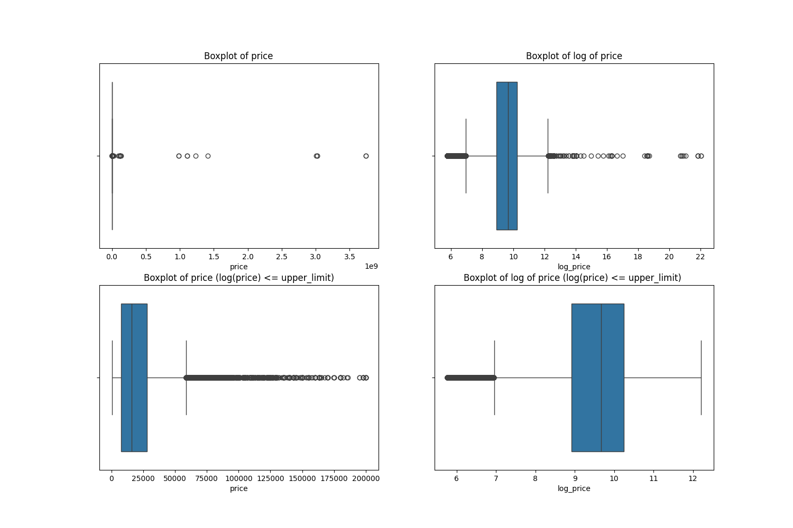

After removing the outliers based on the above explanation, the descriptive statistics and the histogram of price and log price is as follow

1. From the graph, it is clear that the distribution of price is right skewed. However, the distribution of log of price is fairly normal.
2. At the time of model building we will be comparing model performance in predicting both, price and log(price). And choose the once which is better.

|           |  count |    mean |      std |     min |     25% |     50% |     75% |     max |      skew | kurtosis |
| :-------- | -----: | ------: | -------: | ------: | ------: | ------: | ------: | ------: | --------: | -------: |
| price     | 387066 | 19195.4 |  15017.3 |     316 |    7500 |   15775 |   27990 |  200000 |   1.67423 |  6.30062 |
| log_price | 387066 | 9.51162 | 0.943776 | 5.75574 | 8.92266 | 9.66618 | 10.2396 | 12.2061 | -0.890519 |  1.13639 |

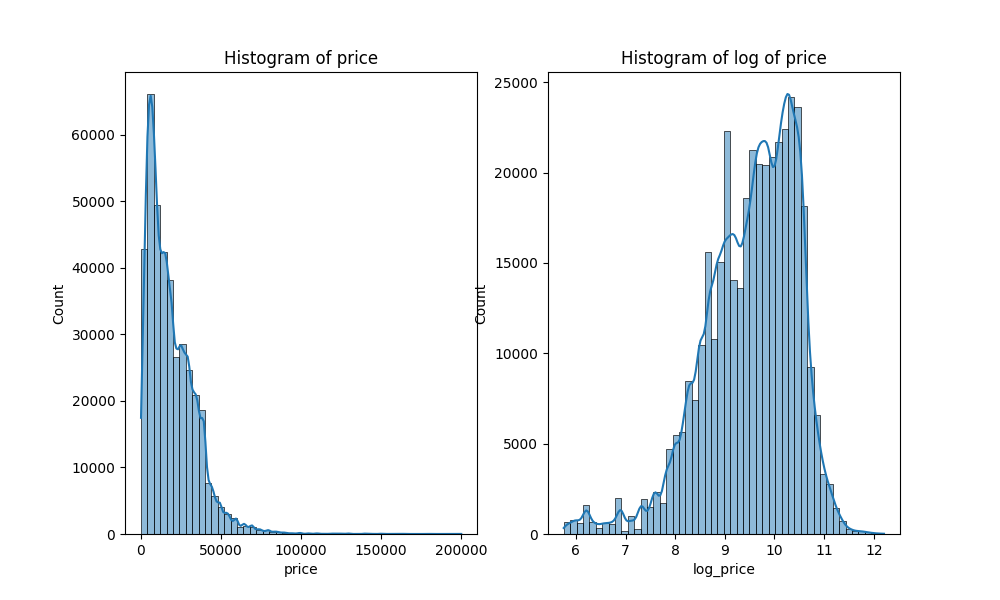

## Odometer Reading (Independent Variable)

The following table contains the descriptive analysis of odometer and cube root of odometer variable. Odometer tells us howm many miles a car has clocked over the years.

1. The min value of odometer is zero, which states there are new cars in the lot
2. There are some extreme values of more than 1 million

|               |  count |    mean |     std | min |     25% |     50% |     75% |     max |
| :------------ | -----: | ------: | ------: | --: | ------: | ------: | ------: | ------: |
| odometer      | 384882 | 98523.3 |  197424 |   0 |   38000 |   87250 |  135927 |   1e+07 |
| cbrt_odometer | 384882 | 42.1194 | 13.5163 |   0 | 33.6198 | 44.3529 | 51.4164 | 215.443 |

These extremen odometer values can impact our model and hence we will truncate them from our data set. In total we have removed 1226 observations, which is less than 0.5% of the total observations.
The box plot will give you a differance between the odometer plots before and after removing outlires.

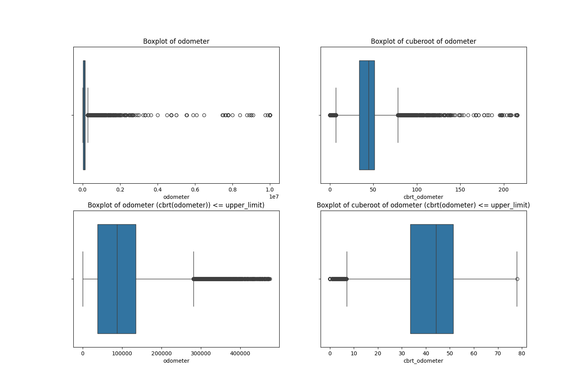

After removing the outlires, descriptive statistics and the histogram of odometer and cuberoot of odometer is as follow.

1. The distribution of odometer is right skewed but the distribbution of cuberoot of qdometer is fairly normal
2. We will compare model performance using both, odometer and cuberoot of odometer, one at a time to select with the best possible results.

|               |  count |    mean |     std | min |     25% |     50% |     75% |     max |      skew | kurtosis |
| :------------ | -----: | ------: | ------: | --: | ------: | ------: | ------: | ------: | --------: | -------: |
| odometer      | 383656 | 92554.2 | 64051.9 |   0 |   37867 |   87000 |  135150 |  475000 |  0.717308 |  0.60168 |
| cbrt_odometer | 383656 | 41.8989 | 12.7812 |   0 | 33.5805 | 44.3105 | 51.3183 | 78.0245 | -0.734692 | 0.433097 |

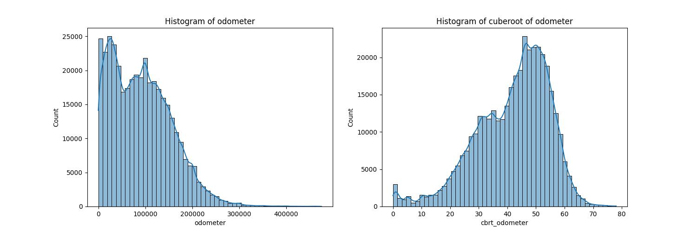

# Feature Engineering

We will analyse all the 17 features for data types, missing values, irregularities, etc and plan necessary data transformations to arrive at quality data for analysis. We will also create new features if needed.

## Droping Values

We want to find the variables which influence the price of the car and to do so we need to analyse the variables, which represent interensic qualities of the car. Hence we will be dropping following columns

1. Id
2. region
3. state

## Data collection issues

There are some issues observed in collection of data. For example we have replaced 'other' with None in columns cylinders, fuel and transmission. As 'other' is not a meaningful value in these columns.

We have also done other general transformation such as all buses are full-size, electric cars have automated transmission, etc.

## Missing Values

We are analysing 4,26,880 observations. The following table will give a peak into the count of non-null value, null values and the data types of for all feature. The size column as the highest percentage(71.77%) of missing values. Followed by number of engine cylinders and car condition.

Note: There is no missing vlaue for price, which is our target variable

|     | columns      | non_null_count | null_count | data_type | percentage_missing |
| --: | :----------- | -------------: | ---------: | :-------- | -----------------: |
|   0 | price        |         387066 |          0 | int64     |                  0 |
|   1 | year         |         385893 |       1173 | float64   |                0.3 |
|   2 | manufacturer |         371401 |      15665 | object    |               4.05 |
|   3 | model        |         382510 |       4556 | object    |               1.18 |
|   4 | condition    |         239829 |     147237 | object    |              38.04 |
|   5 | cylinders    |         229302 |     157764 | object    |              40.76 |
|   6 | fuel         |         384472 |       2594 | object    |               0.67 |
|   7 | odometer     |         384882 |       2184 | float64   |               0.56 |
|   8 | title_status |         379702 |       7364 | object    |                1.9 |
|   9 | transmission |         385248 |       1818 | object    |               0.47 |
|  10 | VIN          |         237572 |     149494 | object    |              38.62 |
|  11 | drive        |         269087 |     117979 | object    |              30.48 |
|  12 | size         |         108472 |     278594 | object    |              71.98 |
|  13 | type         |         303433 |      83633 | object    |              21.61 |
|  14 | paint_color  |         273743 |     113323 | object    |              29.28 |
|  15 | log_price    |         387066 |          0 | float64   |                  0 |

### Nullity Matrix

Out of 17 independent features, 13 features have missing value with missing value percentage of as low as 0.6% to as high as 71.77%. The nullity matrix shows that the corr relation in mssing values is generally weak except for following which have medium correlation

1. type <> drive (0.40)
2. type <> paint_color (0.45)
3. cylinders <> drive (0.43)

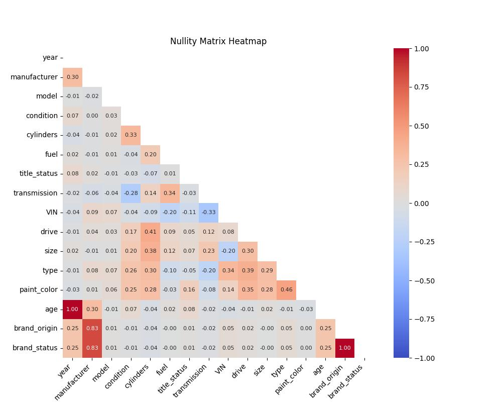

## Data Triangulation

We have done the data triangulation based on the model. The activity has changed the percentage missing of following columns

| sno | columns      | percent_change |
| --: | :----------- | -------------: |
|   1 | manufacturer |         20.466 |
|   2 | cylinders    |        2.22294 |
|   3 | fuel         |       -1056.55 |
|   4 | transmission |       -3291.36 |
|   5 | drive        |        1.83253 |
|   6 | size         |        11.3114 |
|   7 | type         |        6.91952 |

# Exploratory Analysis

In the explortory analysis, we will understand how the price varies across the different categories of the independent variables. Also we will explore the statistical properties of price

## Year

Year variable has a missing percentage of 0.3%. The oldest card observed in the dataset is from year 1900 and the latest card observed in the dataset is from year 2022. The observation from the following plots are as follow

1. The following histogram shows that the most of the cars records in the dataset are from 1990 to 2022.
2. As the year increases, the max price of the car in that year increases
3. As the years pass, the affordable cards in the pool decrease

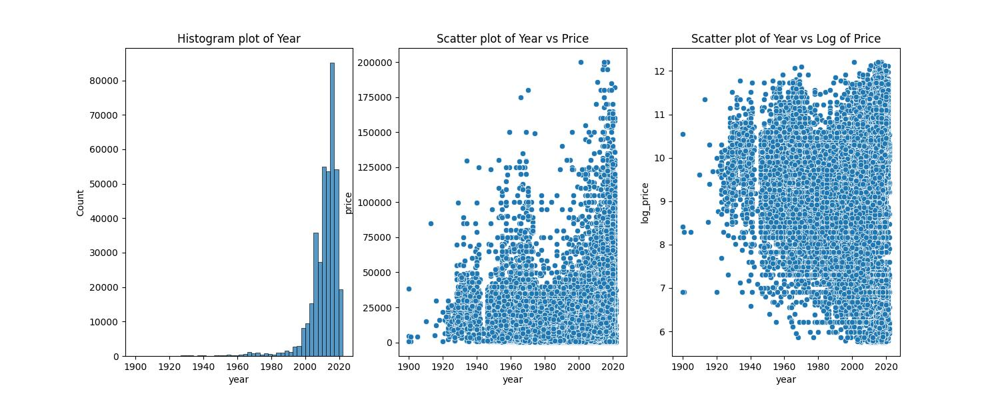

## Manufacturer

In total there are 43 unique values in the manufacturers. The observation from the following plots are as follow

1. Most quantity of cards belong to American and Japanese car manufacturers
2. Most expensive cars belong to European manufacturers, followed by American manufacturers

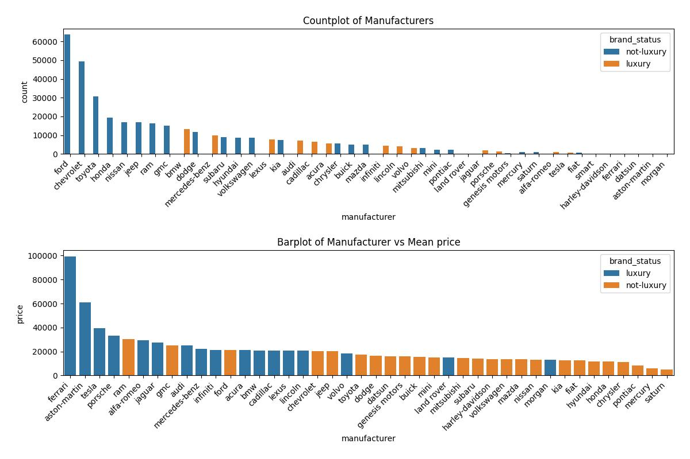

## Condition

The condition of the car has been recorded as follow (in the exact order)

1. New
2. New Like
3. Excellent
4. Good
5. Fair
6. Salvage

The observation from the following graph are following

1. The price of the new vehicle is the highest and it decreases as the condition downgrades
2. Most of the cars in inventory on sale belong to Good and Excellent categories
3. Fair and salvage rouglhy fetches the same price for the car

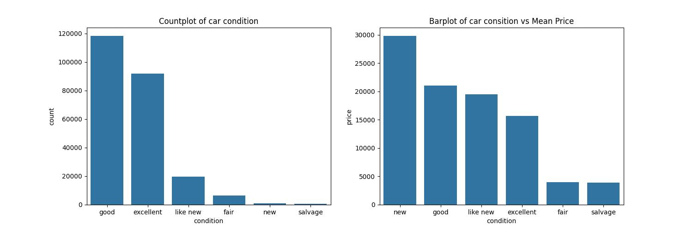

## Cylinders

The cylinders variable has missing value percentage of 40.76%. There are 8 unique values for cylinders. The observation from the following plots are as follow

1. The price of the car decreases as the number of cylinders decreases. However, 3 cylinder cars fetch higher prices than 4 cylinder cars and 4 cylinder cars fetch more price than 5 cylinder cars.
2. Age of the cars (2022-year of manufacturing) for 3 cylinder cars is relatively lower then 4 and 5 cylinder cars. Hence, they fetch higher price

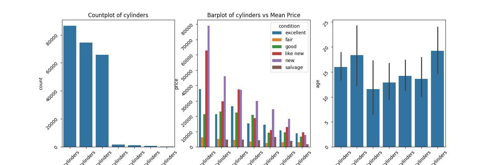

# Fuel

The fuel of the car can be Diesel, Gas, Electric and Hybrid. The missing percentage for fuel is 0.67 percent. The observation of the following plots are as follow

1. Cars powered by gas have the highest inventory
2. Diese powered cars fetch higher price as they are bigger vehicles like trucks, buses, etc.

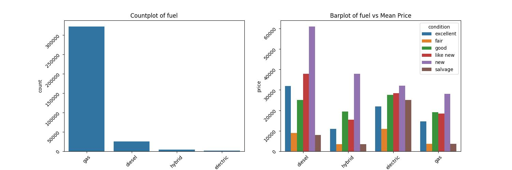

## Odometer

Odometer has a missing percentage of 0.56%. The observtion of the plots are as follow

1. As the odometer increases, price decreases
2. Fair and Salvage condition vehicles have higher odometer values in comparison to others

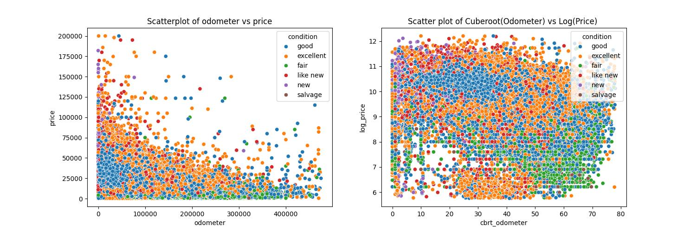

## Title Status

Title status has a missing percentage of 1.9%. There are 6 unique values for title status. The observation of the following plots are as follow

1. Lien title status fetches the higher price in comparison to others
2. There are issues in data collection for this parameter as even rebuilt, missing, salvage, etc title status have condition set as new

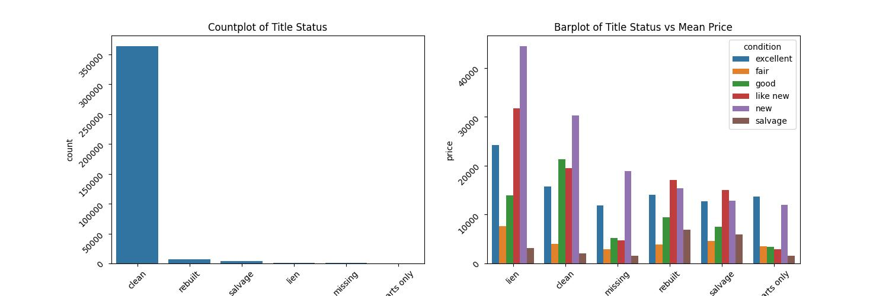

## Transmission

Transmission has 2 unique values, automatic and manual. The observation from the plots are follow

1. Inventory of automatic cars is far greater than manual cars
2. There is not much price differance based on transmission for different car consitions

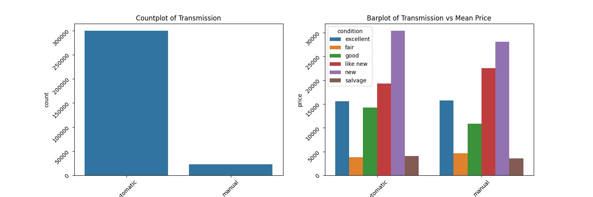

## Drive

Drive has 3 different values

1. fwd: front wheel drive
2. rwd: rear wheel drive
3. 4wd: 4 wheel/all wheel drive

The graph shows that the count of fwd and 4wd vehicles is higher in comparison to rwd vehicles. However, the price of fwd cars is less than others. This is not a conventional knowledge in US car market as 4wd and fwd are mjorly preferred in comparison to rwd vehicles.

Hence, we will not be using this parameter for model training
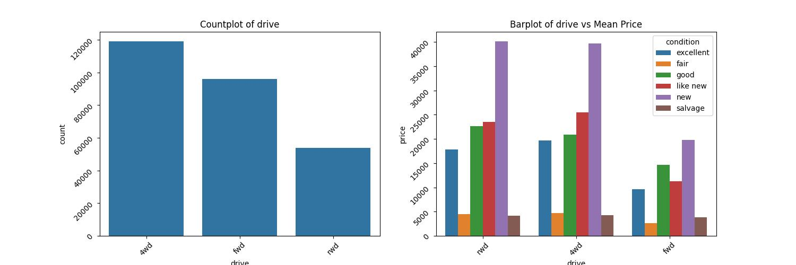

## Size

Size has the highest percentage of missing values i.e. 71.77%. It was requecd to around 64% post data triangulation. However it is still very hight.

1. It is clear from the graph that as the size increases, the price of the car increases
2. The inventory volumes of full-size and mid-size cars are higher in comparison to others

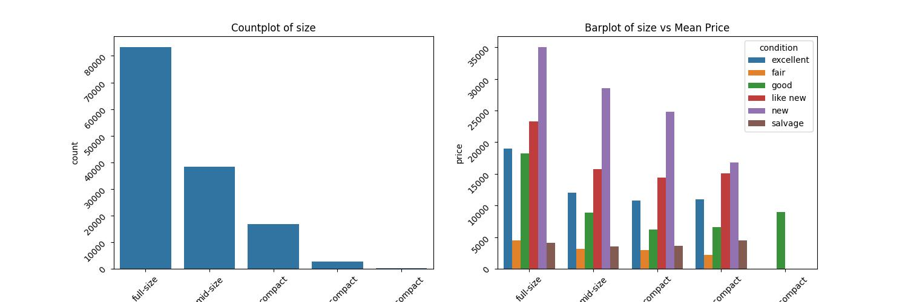

## Type

Type is another category which has a significant percentage of missing values i.e. 21.61%. However, it was reduced to around 20% post data triangulation.

1. Sedans and SUVs selling numbers are higher than any other car type

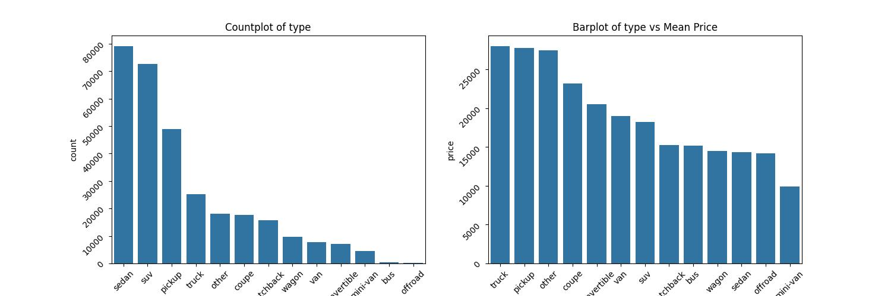

## Paint Color

Most popular paint colors are white and black across all the cars and they fetch higher price in comparison to other colors

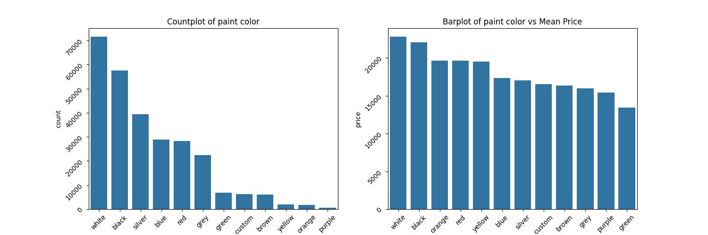

## Outcome

Based on the above exploratory analysis, following set of variables should be selected for model building at they explain price variation much better in comparison to others.

1. Year
2. Condition
3. Cylinders
4. Odometer
5. Size
6. Manufacturer
7. Paint color
8. Type

# Data Preperation

While the above explortory analysis has helped us the independent variables which explains price variations, the following steps were taken to prepare the data for model building. In addition, we will also do on-hot encoding to capture whether the following variables for a given observation were missing or not.

1. Year: Year will be converted to age by substracting 2022 from it.
2. Condition: Will be scored, highest to new and lowest to salvage
3. Odometer: We will explore whether odometer or cuberoot(odometer) is a better predictor
4. Size: Will be scored, highest to full-size and lowest to ultra-compact
5. Manufacturer: Brand status (Luxury or Non-Luxury) and Brand origin (American, European, Asian) have been derived from the manufacturer. This followed by oneHotEncoding
6. Paint color: Paint color has been transformed into Black or White or Others. And then performed oneHotEncoding on it
7. Type: Type has been clubbed into Suv, Sedan, Pickup, Truck & Others and then performed oneHotEncoding on it

## odometer vs cbrt_odometer

Cuberoot of Odometer is a derived feature. However, we cannot keep both as part of our train data set as this leads to high multi-collinearity which can impact our results. After analysing the correlation matrix, we conclude to choose odometer over cbrt_odometer as it has higher correlation with target variables.

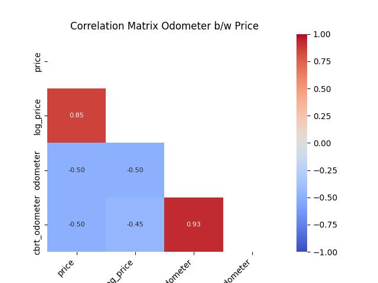

## Multi-Collinearity

The correlation matrix after preprocessing the X_train is as follow. Brand Status and Brand Origin are highly correlated, hence, one needs to be dropped. We will drop Brand Origin as one hot encoding of it will lead to more independent variables, thus increasing model complexity.

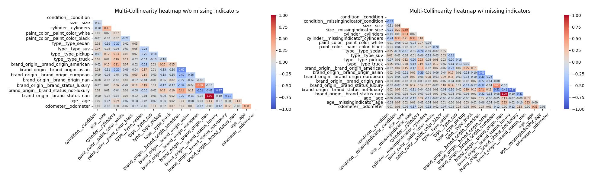

# Model Development & Evaluation

We have used the ordinary linear regression to as a choice for model development. We are compairing 4 models based on the independent and target variables The following RMSE shows the performance on the train data for different models

1. rsme test of model(train): 11213.84
2. rsme test of model w/ missing indicators(train): 11143.65
3. rsme test of model of log price(train): 11374.12
4. rsme test of model w/ missing indicators of log price(train): 11257.43

## Price vs Log Price

The training set RMSE shows that we are not gaining any advantage by building a model for log(price) vs price. Additionally, introducing missing indicatores is not helping us in improving our results. Hence, we will skip the use of missing indicators.

## Model Complexity

We have done the k-fold (k=5) cross validation on the training set to fit the model to calculate the train rmse and validation rmse. The following line chart between model complexity vs rmse show that the model is underfitted as it has not touched the minima. Hence, we have two options to improve the model

1. Increase the number of independent variables to train the model
2. Change the methods from Linear Regression to more advance like random forest, etc.

## Cofficient Values

The following tables shows the cofficient values of independent variables on price. The key observations are

1. More cylinders means higher car value
2. More miles clocked means lesser value
3. Older the car lesser will be its value
4. White colored cars fetch more value than black colored cars
5. Sedans loose a lot of value in comparison to SUVs and Trucks
6. Luxury cars fetch higher price in comparison to non-luxury cars

|     | coef_values | coef_name                        |
| --: | ----------: | :------------------------------- |
|   8 |      9767.4 | type\_\_type_truck               |
|   7 |     7333.34 | type\_\_type_pickup              |
|  12 |    -6429.94 | odometer\_\_odometer             |
|   5 |    -3702.27 | type\_\_type_sedan               |
|  11 |    -3328.51 | age\_\_age                       |
|   9 |    -3306.71 | brand\_\_brand_status_not-luxury |
|   2 |     2725.27 | cylinder\_\_cylinders            |
|  10 |     2377.19 | brand\_\_brand_status_nan        |
|   3 |      1838.3 | paint_color\_\_paint_color_white |
|   4 |     1543.99 | paint_color\_\_paint_color_black |
|   1 |     330.814 | size\_\_size                     |
|   6 |      208.28 | type\_\_type_suv                 |
|   0 |    -162.313 | condition\_\_condition           |

## Test RMSE

The test RMSE of the mode is as follow. This is very close to the train RMSE of 11213.84. Hence, the model is not overfitting.

rmse of price (test): 11235.173333741797

## Permutation Table

The following table shows the drift in the rsme based on the feature being removed from the model. This tells us the relative order in which independent variables influence the model the most

| feature_count | features                                                                             |    delta |
| ------------: | :----------------------------------------------------------------------------------- | -------: |
|            13 | ('condition', 'size', 'cylinder', 'paint_color', 'type', 'brand', 'age', 'odometer') |  1.04922 |
|            12 | ('condition', 'size', 'cylinder', 'paint_color', 'type', 'brand', 'age')             | -1510.84 |
|            11 | ('condition', 'size', 'cylinder', 'paint_color', 'type', 'brand')                    | -2485.78 |
|            10 | ('condition', 'size', 'paint_color', 'type', 'brand')                                | -2592.96 |
|             9 | ('condition', 'paint_color', 'type', 'brand')                                        | -2575.84 |
|             8 | ('condition', 'size', 'paint_color', 'type')                                         | -2701.82 |
|             7 | ('condition', 'paint_color', 'type')                                                 | -2463.09 |
|             6 | ('condition', 'size', 'paint_color', 'brand')                                        | -2724.28 |
|             5 | ('condition', 'paint_color', 'brand')                                                | -2891.84 |
|             4 | ('paint_color', 'brand')                                                             | -2895.17 |
|             3 | ('condition', 'brand')                                                               | -2584.32 |
|             2 | ('brand',)                                                                           | -1934.92 |

The order of influence is as follow

1. Odometer
2. Age
3. Cylinders
4. Type
5. Size
6. Condition
7. Paint Color
8. Brand

# Observations

1. More cylinders means higher car value
2. More miles clocked means lesser value
3. Older the car lesser will be its value
4. White colored cars fetch more value than black colored cars
5. Sedans loose a lot of value in comparison to SUVs and Trucks
6. Luxury cars fetch higher price in comparison to non-luxury cars
7. Independent variables influence the car price in following order
   1. Odometer
   2. Age
   3. Cylinders
   4. Type
   5. Size
   6. Condition
   7. Paint Color
   8. Brand

## Next Steps

Based on the analysis, here are the next steps

1. Try to build the modle with more advance algorithms like random forest, etc and capture the reduction in RMSE. The current RMSE is quite high
2. Try to introduce new features from the existing dataset to improve the model performance
3. Recollect the data to reduce missing values and outliers for better model development.
